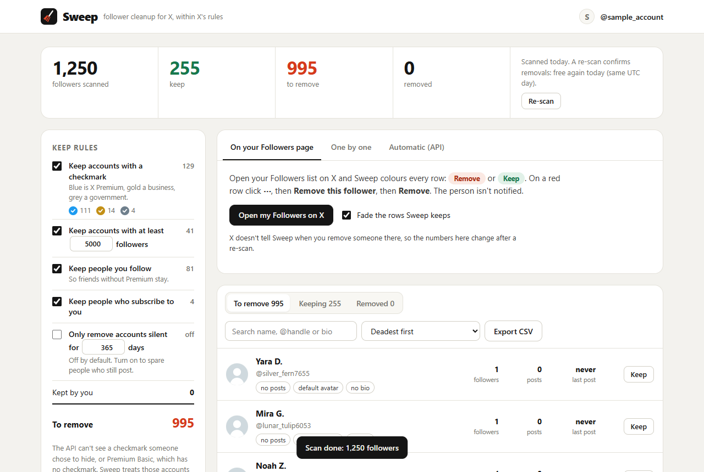
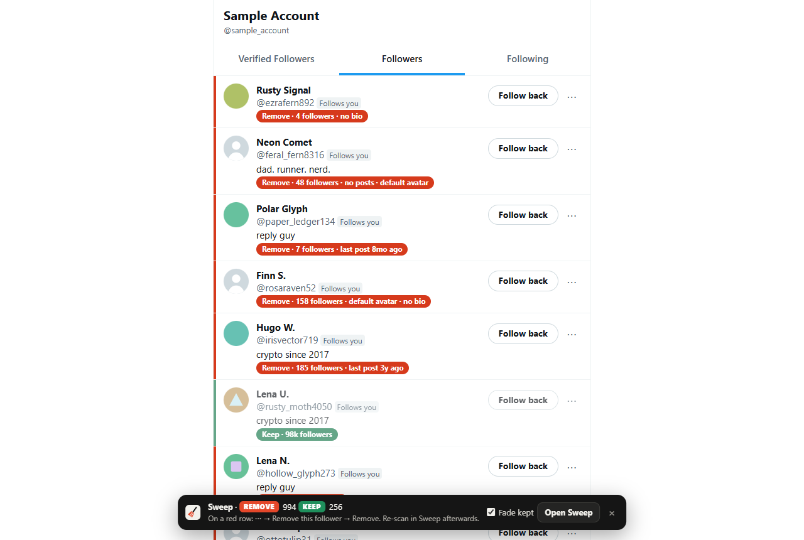
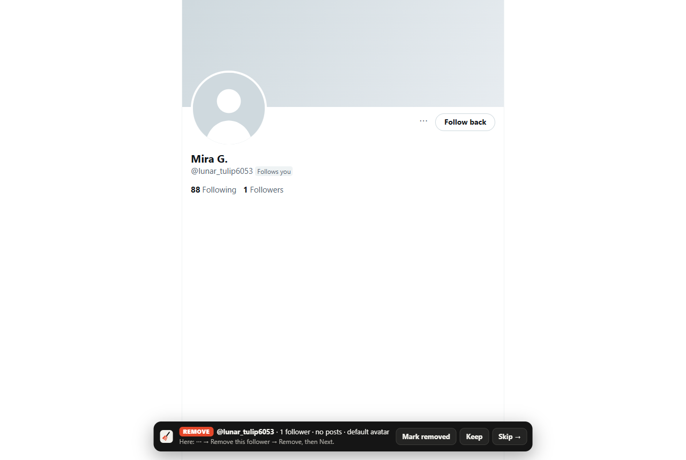

<div align="center">


# Sweep

**Clean dead followers off your X account without breaking X's rules.**

A free, open-source Chrome extension. It reads your followers through the official X API, decides who looks dead, and marks them right on your Followers page.

[](https://github.com/winchxyz/follower-sweep/releases/latest)
[](LICENSE)
[](https://github.com/winchxyz/follower-sweep/stargazers)
[](https://x.com/winchxyz)

**If Sweep saves you an afternoon, [star the repo](https://github.com/winchxyz/follower-sweep) and [follow @winchxyz](https://x.com/winchxyz) for the next tools.**



</div>

## Why Sweep

Bot and dead followers drag your reach down and make your follower count a lie. Most cleanup tools either cost a monthly subscription or "automate" x.com by clicking for you, which X's automation rules punish with **permanent suspension**.

Sweep does neither:

- **Official API only.** It signs in with OAuth 2.0 through your own developer app. It never sees your password, never scrapes, and never clicks on x.com for you.
- **Cheap.** You pay X directly, about **$1 per 1,000 followers** scanned. A 23,000-follower account cost $25 in a real run, and a second scan on the same UTC day is free.
- **Your data stays with you.** Everything lives in your browser's extension storage. No server, no account, no analytics.

## What it does

| | |
|---|---|
| **Scan** | Reads every follower with `GET /2/users/:id/followers`, 1,000 per request. It's resumable, so a closed tab or a rate limit only pauses it. |
| **Decide** | Removes accounts without a checkmark and under 5,000 followers by default. It keeps people you follow and people who subscribe to you, and you can keep anyone by hand. Every rule is a toggle. |
| **Spot the dead** | Sorts deadest first: no posts, default avatar, no bio, silent for a year, follows thousands but has no followers, brand new. The last post date comes free from the post ID, with no extra API reads. |
| **Inactivity filter** | "Only remove accounts silent for N days", with a live count of how many accounts that catches. |
| **Mark on x.com** | Every row on your Followers page gets a red *Remove* or green *Keep* label with the reason. Kept rows fade out. |
| **One by one** | Opens profiles deadest first, with a bar saying why. It notices when "Follows you" disappears and moves on. |
| **Following too** | Scans who *you* follow, shows who doesn't follow you back and who looks dead, and marks your Following page on x.com. It notices when you unfollow someone on their profile. You do the unfollowing, since X bans mass auto-unfollowing. |
| **Verify** | A re-scan confirms who's gone and puts back anyone still following. |
| **Export** | CSV of everyone with their verdict, safe from spreadsheet formula injection. |
| **Try first** | A sample mode with 1,250 made-up followers, no X account needed. |

<p align="center">
  
  
</p>

## What X allows, and why the last click is yours

| | X's rules | Sweep |
|---|---|---|
| Reading your followers | Allowed through the API with your own app | ✅ Official endpoint |
| Bots clicking on x.com | **Banned**, with permanent suspension | ❌ Never |
| "Remove follower" API | Doesn't exist | — |
| Soft block (block, then unblock) | Enterprise plan only | Optional, stops at the first refusal |

So Sweep does the scanning, the sorting and the marking, and you press **⋯ → Remove this follower** in X's own menu.

## Install

1. Download `sweep-extension.zip` from the [latest release](https://github.com/winchxyz/follower-sweep/releases/latest) and unzip it.
2. Open `chrome://extensions`, switch on **Developer mode**, click **Load unpacked**, and pick the unzipped folder. It works in Chrome, Edge, Brave and Arc.
3. Sweep opens. Want to look around first? Click **Try it with sample followers**.

## Connect your X developer app (about 5 minutes)

1. Go to [console.x.com](https://console.x.com) **signed in as the account you want to clean**. Reads of your own followers then bill as cheap "owned reads".
2. Create an app. Under **User authentication settings** pick **OAuth 2.0**, app type **Native App**, permission **Read**.
3. Callback URI: `https://ojfmjajpdhdpjekhnlmjpphmmmngochn.chromiumapp.org/x`. The extension ID is pinned by the manifest key, so this is the same for everyone. Website URL can be your X profile.
4. Add a few dollars of credit. Saving a card currently earns $20 of free credit.
5. Paste the **OAuth 2.0 Client ID** into Sweep and click **Sign in with X**.

### "X answered 401 to GET /2/users/me"

Some new pay-per-use apps get their sign-in token refused by X even though everything is set up right; only X staff can fix that. Sweep shows the request ID for your support ticket. Meanwhile, open **"Use your app's Bearer Token instead"**, paste the Bearer Token from **Keys & Tokens**, and scan anyway. For your own account it bills at the same owned-read price.

## Costs

| | X pay-per-use price |
|---|---|
| Scan | about $0.001 per follower |
| Scan again the same UTC day | free (X counts each account once a day) |
| Soft block + unblock, if your plan allows it | $0.001 each |

Sweep shows the estimate before it reads anything.

## Privacy

Sweep talks only to `api.x.com`. Your follower list, your marks and your tokens stay in this browser. **Disconnect X** revokes the token, and **Delete all Sweep data** wipes everything. The x.com script only reads the page and Sweep's own storage.

## Develop

```bash
npm test          # rules, sign-in, scan, fallbacks, re-scan and soft block, against a local X stand-in
npm run e2e       # loads the real extension in Chromium via Playwright; screenshots land in dev/shots/
npm run stub      # the local X stand-in on :3799 (client id demo-client-id-123)
npm run icons     # redraws the PNG icons
```

`npm run e2e` needs `playwright-core`: install it, or point `PLAYWRIGHT_CORE` at an existing `playwright-core/index.mjs`. There are no runtime dependencies.

```
extension/
  manifest.json      MV3, pinned key, api.x.com host permission, content script on x.com
  app.html/.css/.js  setup, sign-in, scan, rules, list, removal methods
  content/           x.com: row marks, profile bar, "Follows you" watcher (read-only)
  lib/xapi.js        OAuth 2.0 PKCE, Bearer mode, token refresh, errors with X request IDs
  lib/scan.js        paged, resumable scan; field and mutuals fallbacks; re-scan reconcile
  lib/rules.js       keep rules, dead signals, sorting
  lib/apiremove.js   optional soft block with pacing, daily cap and leftover-block recovery
dev/                 X stand-in server, end-to-end run
test/                node:test suites
```

Pull requests are welcome. Keep it within X's rules: no clicking on x.com, no scraping.

## Limits

- The API can't see a checkmark someone hid, or Premium Basic, which has no checkmark. Those accounts count as having none.
- The x.com marks rely on X's page markup (`UserCell`, `userFollowIndicator`). If X renames those, the marks disappear, but scanning, review and export keep working.
- Removals made on the Followers page show up after a re-scan; X doesn't tell extensions about them.

## License

[MIT](LICENSE). Not affiliated with X Corp.

<div align="center">

Made by [@winchxyz](https://x.com/winchxyz) · if it helped, a ⭐ helps others find it

</div>
